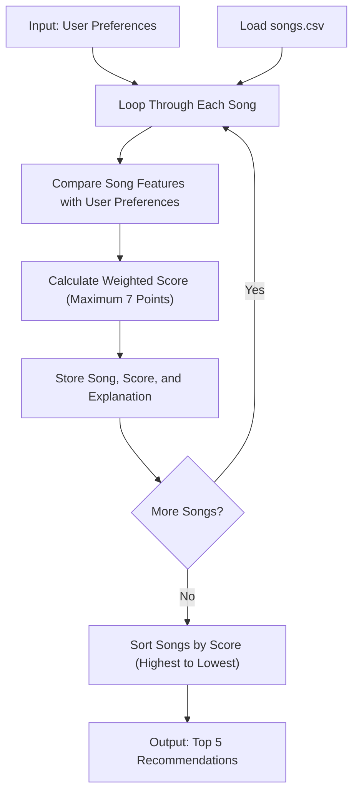

# 🎵 Music Recommender Simulation

## Project Summary

In this project you will build and explain a small music recommender system.

Your goal is to:

- Represent songs and a user "taste profile" as data
- Design a scoring rule that turns that data into recommendations
- Evaluate what your system gets right and wrong
- Reflect on how this mirrors real world AI recommenders

Replace this paragraph with your own summary of what your version does.

---

## How The System Works

Explain your design in plain language.

Real-world applications like Spotify, use recommednation systmes to help recommend songs to users. For example, if people have similar taste and they liked a specific song then the system will probably suggest that song to the other person with similar taste. Also, these applications might also analyze your most listened songs and liked songs.
Meanwhile other systems may use content-based filering as well. The system might recommend similar sings based on the song's genre, mood, or other features.

The music recommendation for the project will use content-based filtering based on the user's prefernces of music. So, this system will compare songs with the user perferred songs to decide what music songs to recommend.

Songs have several features:

- Title
- Genre
- Artist name
- Mood
- Tempo
- Acousticness
- Danceability
- Energy
- Valence

For the system, the User Profile will store the user's prefernces. These include:

- Preferred genre
- Preferred mood
- Preferred energy level
- Preferred tempo
- Preferred valence
- Preferred danceability
- Whether they like acoustic music

The Recommender compares each song's features against the user's preferences.

For example:

- Matching the preferred genre earns more points.
- Matching the preferred mood earns more points.
- Energy, valence, and other numerical features receive higher scores when they are closer to the user's preferred values.

After calculating the scores, the system will rank from highest to the lowest and retrieve the top 5 songs with the highest scores.

### Algorithm Recipe

The recommender uses a weighted scoring system with a maximum possible score of 7.0 points.

| Feature      | Scoring Rule                                               | Maximum Points |
| ------------ | ---------------------------------------------------------- | -------------: |
| Genre        | +2.0 if the song's genre matches the user's favorite genre |            2.0 |
| Mood         | +1.0 if the song's mood matches the user's favorite mood   |            1.0 |
| Energy       | 1.5 × (1 - absolute difference)                            |            1.5 |
| Valence      | 1.0 × (1 - absolute difference)                            |            1.0 |
| Tempo        | 0.5 × max(0, 1 - absolute difference / 100)                |            0.5 |
| Danceability | 0.5 × (1 - absolute difference)                            |            0.5 |
| Acousticness | 0.5 × (1 - absolute difference)                            |            0.5 |
| **Total**    |                                                            |        **7.0** |

For numerical features between 0 and 1, similarity is calculated using:

`Similarity = 1 - abs(song_value - target_value)`

For tempo, the difference is divided by 100 BPM, and the similarity cannot fall below zero.

### Potential Biases and Limitations

The recommendation system has several potential biases and limitations:

- **Genre Prioritization:** Genre receives 2.0 points. The most points out of all. This means genre will be prioritized more than other fetaures
- **Limited Dataset:** The dataset contains only 18 songs, so recommendations are limited.
- **Matching:** Genre and moods require exact matches. For example, "indie pop" and "pop" are treated differently.
- **Diversity:** Not much variety of artists and some recommendations may coem from same artist or genre.

The following flowchart illustrates how the Music Recommender processes user preferences and ranks songs from the CSV dataset.



---

## Getting Started

### Setup

1. Create a virtual environment (optional but recommended):

   ```bash
   python -m venv .venv
   source .venv/bin/activate      # Mac or Linux
   .venv\Scripts\activate         # Windows

   ```

2. Install dependencies

```bash
pip install -r requirements.txt
```

3. Run the app:

```bash
python -m src.main
```

### Running Tests

Run the starter tests with:

```bash
pytest
```

You can add more tests in `tests/test_recommender.py`.

---

## Sample Recommendation Output

Paste a sample of your recommender's output here as a text block so a reader can see what it produces:

```
# e.g.:
# User profile: genre=indie, mood=chill, energy=low
# Recommendations:
#   1. ...
#   2. ...
#   3. ...
```

**Screenshot or video** _(optional)_: <!-- Insert a screenshot or demo video link here -->

---

## Experiments You Tried

Use this section to document the experiments you ran. For example:

- What happened when you changed the weight on genre from 2.0 to 0.5
- What happened when you added tempo or valence to the score
- How did your system behave for different types of users

---

## Limitations and Risks

Summarize some limitations of your recommender.

Examples:

- It only works on a tiny catalog
- It does not understand lyrics or language
- It might over favor one genre or mood

You will go deeper on this in your model card.

---

## Reflection

Read and complete `model_card.md`:

[**Model Card**](model_card.md)

Write 1 to 2 paragraphs here about what you learned:

- about how recommenders turn data into predictions
- about where bias or unfairness could show up in systems like this
