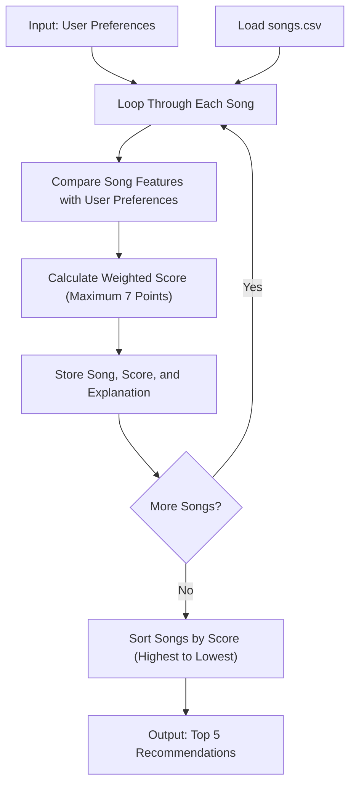

# 🎵 Music Recommender Simulation

## Project Summary

In this project I will build a music recommender system. This system will take into account genre, mood, energy, and among other important features. These features will be used by the scoring system established in the project. Each song will be given a score and then the system will recommend the top 5 results to users.

---

## How The System Works

Explain your design in plain language.

Real-world applications like Spotify, use recommednation systmes to help recommend songs to users. For example, if people have similar taste and they liked a specific song then the system will probably suggest that song to the other person with similar taste. Also, these applications might also analyze your most listened songs and liked songs.
Meanwhile other systems may use content-based filering as well. The system might recommend similar sings based on the song's genre, mood, or other features.

The music recommendation for the project will use content-based filtering based on the user's prefernces of music. So, this system will compare songs with the user perferred songs to decide what music songs to recommend.

Songs have several features:

- Title
- Genre
- Artist name
- Mood
- Tempo
- Acousticness
- Danceability
- Energy
- Valence

For the system, the User Profile will store the user's prefernces. These include:

- Preferred genre
- Preferred mood
- Preferred energy level
- Preferred tempo
- Preferred valence
- Preferred danceability
- Whether they like acoustic music

The Recommender compares each song's features against the user's preferences.

For example:

- Matching the preferred genre earns more points.
- Matching the preferred mood earns more points.
- Energy, valence, and other numerical features receive higher scores when they are closer to the user's preferred values.

After calculating the scores, the system will rank from highest to the lowest and retrieve the top 5 songs with the highest scores.

### Algorithm Recipe

The recommender uses a weighted scoring system with a maximum possible score of 7.0 points.

| Feature      | Scoring Rule                                               | Maximum Points |
| ------------ | ---------------------------------------------------------- | -------------: |
| Genre        | +2.0 if the song's genre matches the user's favorite genre |            2.0 |
| Mood         | +1.0 if the song's mood matches the user's favorite mood   |            1.0 |
| Energy       | 1.5 × (1 - absolute difference)                            |            1.5 |
| Valence      | 1.0 × (1 - absolute difference)                            |            1.0 |
| Tempo        | 0.5 × max(0, 1 - absolute difference / 100)                |            0.5 |
| Danceability | 0.5 × (1 - absolute difference)                            |            0.5 |
| Acousticness | 0.5 × (1 - absolute difference)                            |            0.5 |
| **Total**    |                                                            |        **7.0** |

For numerical features between 0 and 1, similarity is calculated using:

`Similarity = 1 - abs(song_value - target_value)`

For tempo, the difference is divided by 100 BPM, and the similarity cannot fall below zero.

### Potential Biases and Limitations

The recommendation system has several potential biases and limitations:

- **Genre Prioritization:** Genre receives 2.0 points. The most points out of all. This means genre will be prioritized more than other fetaures
- **Limited Dataset:** The dataset contains only 18 songs, so recommendations are limited.
- **Matching:** Genre and moods require exact matches. For example, "indie pop" and "pop" are treated differently.
- **Diversity:** Not much variety of artists and some recommendations may coem from same artist or genre.

The following flowchart illustrates how the Music Recommender processes user preferences and ranks songs from the CSV dataset.



---

## Getting Started

### Setup

1. Create a virtual environment (optional but recommended):

   ```bash
   python -m venv .venv
   source .venv/bin/activate      # Mac or Linux
   .venv\Scripts\activate         # Windows

   ```

2. Install dependencies

```bash
pip install -r requirements.txt
```

3. Run the app:

```bash
python -m src.main
```

### Running Tests

Run the starter tests with:

```bash
pytest
```

You can add more tests in `tests/test_recommender.py`.

---

## Sample Recommendation Output

Paste a sample of your recommender's output here as a text block so a reader can see what it produces:

```
Loaded songs: 18

Top recommendations:

Sunrise City - Score: 6.91
Because: genre match (+2.0), mood match (+1.0), energy similarity (+1.47), valence similarity (+0.96), tempo similarity (+0.49), danceability similarity (+0.49), acousticness similarity (+0.49)

Gym Hero - Score: 5.60
Because: genre match (+2.0), energy similarity (+1.30), valence similarity (+0.97), tempo similarity (+0.44), danceability similarity (+0.46), acousticness similarity (+0.42)

Rooftop Lights - Score: 4.82
Because: mood match (+1.0), energy similarity (+1.44), valence similarity (+0.99), tempo similarity (+0.48), danceability similarity (+0.49), acousticness similarity (+0.43)

Funky Weekend - Score: 3.69
Because: energy similarity (+1.38), valence similarity (+0.94), tempo similarity (+0.48), danceability similarity (+0.43), acousticness similarity (+0.46)

City Bounce - Score: 3.65
Because: energy similarity (+1.41), valence similarity (+0.94), tempo similarity (+0.42), danceability similarity (+0.45), acousticness similarity (+0.44)
```

**Screenshot or video** _(optional)_: <!-- Insert a screenshot or demo video link here -->

---

## Experiments You Tried

I tested the recommendation system using four different user profiles: High-Energy Pop, Chill Lofi, Deep Intense Rock, and Conflicting Preferences.

I also performed a weight-shift experiment. I reduced the genre weight from 2.0 to 1.0 and increased the energy weight from 1.5 to 3.0.

---

## Limitations and Risks

- Dataset only had 18 songs. There is not much variety
- Energy similarity has a high weight of 3.0 in the experiment and can strongly influence ranking.
- Needs exact word genre matching. For example, indie pop and pop are not the same in the system, even if related.

---

## Reflection

Read and complete `model_card.md`:

[**Model Card**](model_card.md)

Write 1 to 2 paragraphs here about what you learned:

- about how recommenders turn data into predictions
- about where bias or unfairness could show up in systems like this
